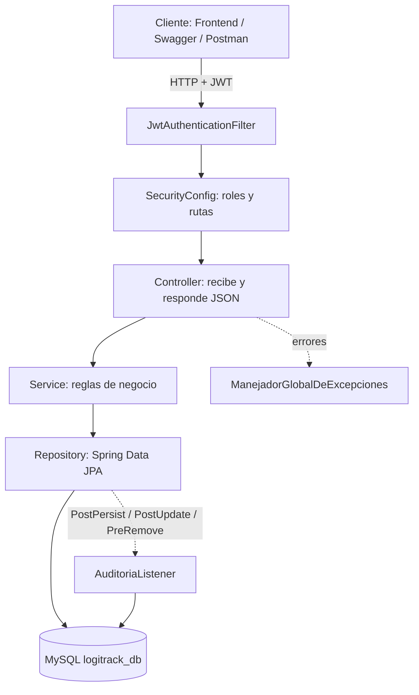
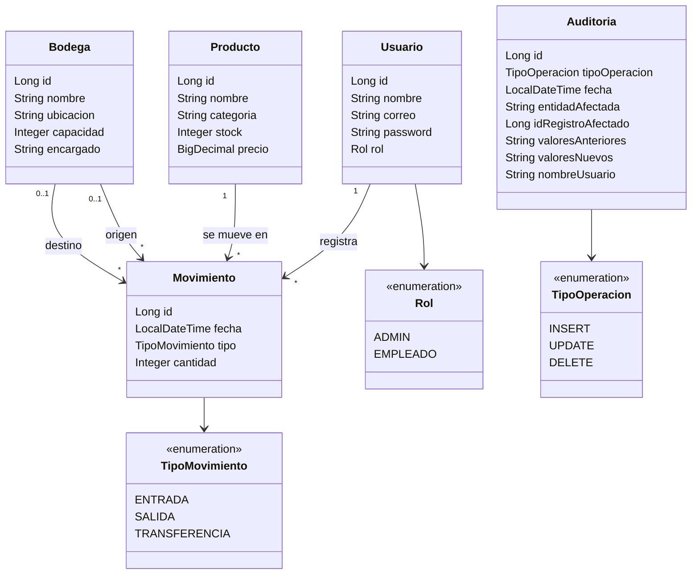

# 📦 LogiTrack — Sistema de Gestión y Auditoría de Bodegas
 
Backend REST en **Spring Boot** para **LogiTrack S.A.**, empresa que administra varias bodegas en distintas ciudades. Centraliza el control de productos, bodegas y movimientos de inventario (entradas, salidas y transferencias), registra automáticamente los cambios en una auditoría y protege la información con **autenticación JWT** y control de acceso por roles. Incluye un frontend básico en HTML/CSS/JS para probar el login y las consultas principales.
 
---
 
## 📑 Contenido
 
1. [Objetivo](#-objetivo)
2. [Funcionalidades](#-funcionalidades)
3. [Tecnologías](#-tecnologías)
4. [Arquitectura](#-arquitectura)
5. [Diagrama de clases](#-diagrama-de-clases)
6. [Estructura del proyecto](#-estructura-del-proyecto)
7. [Instalación y ejecución](#-instalación-y-ejecución)
8. [Usuarios de prueba](#-usuarios-de-prueba)
9. [Seguridad y JWT](#-seguridad-y-jwt)
10. [Endpoints](#-endpoints)
11. [Ejemplos de uso](#-ejemplos-de-uso)
12. [Reglas de negocio](#-reglas-de-negocio)
13. [Auditoría](#-auditoría)
14. [Manejo de errores](#-manejo-de-errores)
15. [Documentación Swagger y pruebas](#-documentación-swagger-y-pruebas)
16. [Frontend](#-frontend)
17. [Usarlo desde el celular](#-usarlo-desde-el-celular)
18. [Limitaciones conocidas](#-limitaciones-conocidas)
---
 
## 🎯 Objetivo
 
Desarrollar un sistema de gestión y auditoría de bodegas que permita registrar transacciones de inventario y consultar un historial auditable de los cambios realizados por cada usuario, reemplazando el control manual en hojas de cálculo que no ofrecía trazabilidad ni control de accesos.
 
## ✨ Funcionalidades
 
| Módulo | Qué permite |
|---|---|
| **Bodegas** | Registrar, consultar, actualizar y eliminar bodegas (id, nombre, ubicación, capacidad, encargado). |
| **Productos** | CRUD completo (id, nombre, categoría, stock, precio) y consulta de productos con **stock bajo** (menos de 10 unidades). |
| **Movimientos** | Registrar entradas, salidas y transferencias entre bodegas. Guarda fecha, tipo, cantidad, producto, bodega origen/destino y el usuario responsable (tomado del token). |
| **Auditoría** | Registro automático de operaciones INSERT, UPDATE y DELETE mediante un *EntityListener* de JPA, con fecha, usuario y entidad afectada. |
| **Seguridad** | Spring Security + JWT, contraseñas cifradas con BCrypt y roles `ADMIN` / `EMPLEADO`. |
| **Usuarios** | Administración de usuarios del sistema y sus roles. |
| **Errores y validaciones** | Manejo global con `@ControllerAdvice`, validaciones con Bean Validation y respuestas JSON uniformes. |
| **Documentación** | API documentada con Swagger / OpenAPI 3 y soporte para probar endpoints protegidos con el token. |
| **Frontend** | Panel web (login, dashboard, productos, bodegas, movimientos y auditoría). |
 
## 🛠 Tecnologías
 
| Capa | Tecnología |
|---|---|
| Lenguaje | Java 21 |
| Framework | Spring Boot 3.4.1 (Web, Data JPA, Validation, Security) |
| Base de datos | MySQL 8 |
| Autenticación | JWT (JJWT 0.12.3) |
| Documentación | springdoc-openapi 2.8.4 (Swagger UI) |
| Utilidades | Lombok, Maven |
| Servidor | Tomcat embebido |
| Frontend | HTML5, CSS3 y JavaScript (sin frameworks) |
 
## 🏗 Arquitectura
 
El backend sigue una **arquitectura en capas**:
 

 
| Capa | Paquete | Responsabilidad |
|---|---|---|
| Controller | `controller` | Expone los endpoints REST y la documentación Swagger. |
| Service | `service` | Contiene la lógica de negocio (stock, usuario del movimiento, cifrado de contraseñas). |
| Repository | `repository` | Acceso a datos con Spring Data JPA. |
| Modelo | `modelo` | Entidades JPA, enums y validaciones. |
| Security | `security` | Filtro JWT, generación y validación de tokens, reglas de acceso y listener de auditoría. |
| Config | `config` | Configuración de OpenAPI/Swagger y utilidades de Spring. |
| Exception | `exception` | Manejo global de errores y respuestas JSON personalizadas. |
 
**Flujo de una petición:** el cliente envía el token → `JwtAuthenticationFilter` lo valida y carga el rol → `SecurityConfig` decide si la ruta está permitida → el controlador delega en el servicio → el repositorio accede a MySQL. Si algo falla, `ManejadorGlobalDeExcepciones` devuelve un JSON de error.
 
## 🧩 Diagrama de clases
 

 
**Base de datos (tablas):** `usuario`, `producto`, `bodega`, `movimiento` y `auditoria`. En `movimiento`, las claves foráneas a `usuario` y `producto` son obligatorias, y las de `bodega_origen` y `bodega_destino` son opcionales (una ENTRADA no tiene origen y una SALIDA no tiene destino). `auditoria` guarda el nombre del usuario como texto para conservar el historial aunque el usuario se elimine.
 
## 📂 Estructura del proyecto
 
```
Backend/
└── logitrack/
    ├── pom.xml
    └── src/main/
        ├── java/com/example/logitrack/
        │   ├── LogitrackApplication.java
        │   ├── config/          # OpenApiConfig, SpringContextHolder
        │   ├── controller/      # Auth, Producto, Bodega, Movimiento, Usuario, Auditoria
        │   ├── dto/             # LoginRequest
        │   ├── exception/       # ManejadorGlobalDeExcepciones, ErrorResponse, RecursoNoEncontradoException
        │   ├── modelo/          # Usuario, Producto, Bodega, Movimiento, Auditoria + enums
        │   ├── repository/      # Repositorios Spring Data JPA
        │   ├── security/        # SecurityConfig, JwtUtils, JwtAuthenticationFilter,
        │   │                    # CustomUserDetailsService, AuditoriaListener
        │   └── service/         # Lógica de negocio
        └── resources/
            ├── application.properties
            ├── schema.sql       # Estructura de la base de datos
            ├── data.sql         # Datos iniciales de prueba
            └── static/          # Frontend (HTML, CSS y JS), servido por Spring Boot
                ├── index.html
                ├── login.html
                ├── css/
                └── js/
```
 
## 🚀 Instalación y ejecución
 
### Requisitos previos
 
- **JDK 21**
- **MySQL 8** en ejecución en `localhost:3306`
- **Maven** (o el wrapper incluido: `mvnw` / `mvnw.cmd`)
- IntelliJ IDEA (opcional) y un navegador moderno
### 1. Clonar el repositorio
 
```bash
git clone https://github.com/orduzdarney-dot/Project_LogicTrack.git
cd Project_LogicTrack/Backend/logitrack
```
 
### 2. Configurar la base de datos
 
Edita `src/main/resources/application.properties` con tus credenciales de MySQL:
 
```properties
spring.datasource.url=jdbc:mysql://localhost:3306/logitrack_db?createDatabaseIfNotExist=true
spring.datasource.username=root
spring.datasource.password=1234
server.port=8080
```
 
La base `logitrack_db` se crea sola si no existe. Al arrancar, Spring ejecuta `schema.sql` (crea las tablas) y `data.sql` (carga usuarios, bodegas y productos de prueba).
 
### 3. Ejecutar
 
**Desde IntelliJ:** abre la clase `LogitrackApplication` y pulsa **Run ▶**.
 
**Desde la terminal:**
 
```bash
./mvnw spring-boot:run        # Linux / macOS / Git Bash
mvnw.cmd spring-boot:run      # Windows (CMD o PowerShell)
```
 
Cuando aparezca `Started LogitrackApplication`, la aplicación queda disponible en:
 
| Recurso | URL |
|---|---|
| Frontend (login) | http://localhost:8080/login.html |
| Swagger UI | http://localhost:8080/swagger-ui/index.html |
| OpenAPI (JSON) | http://localhost:8080/v3/api-docs |
 
> ⚠️ `schema.sql` elimina y recrea todas las tablas en cada arranque (`DROP TABLE IF EXISTS`). Los datos se reinician cada vez que se inicia la aplicación.
 
## 👤 Usuarios de prueba
 
Cargados desde `data.sql`. **La contraseña de todos es `12345`.**
 
| Nombre | Correo | Rol |
|---|---|---|
| admin1 | admin@logitrack.com | ADMIN |
| juan_perez | empleado@logitrack.com | EMPLEADO |
| maria_gomez | maria@logitrack.com | EMPLEADO |
 
También se cargan 3 bodegas (Quito, Medellín y Loja) y 8 productos de ejemplo.
 
## 🔐 Seguridad y JWT
 
1. El usuario envía su **correo y contraseña** a `POST /auth/login`.
2. El servidor verifica las credenciales (contraseña cifrada con BCrypt) y devuelve un **token JWT** válido por **24 horas**.
3. El cliente envía el token en cada petición: `Authorization: Bearer <token>`.
4. `JwtAuthenticationFilter` valida la firma y la expiración, y `SecurityConfig` aplica los permisos según el rol.
### Ejemplo de token
 
Un JWT tiene tres partes separadas por puntos: `encabezado.contenido.firma`.
 
```
eyJhbGciOiJIUzUxMiJ9.<contenido>.<firma>
```
 
Contenido (payload) decodificado de un token de `admin1`:
 
```json
{
  "sub": "admin1",
  "role": "ADMIN",
  "iat": 1795130000,
  "exp": 1795216400
}
```
 
| Campo | Significado |
|---|---|
| `sub` | Nombre del usuario autenticado |
| `role` | Rol del usuario (`ADMIN` o `EMPLEADO`) |
| `iat` | Fecha de emisión (segundos Unix) |
| `exp` | Fecha de expiración (24 horas después) |
 
### Uso del token
 
```bash
# 1. Obtener el token
curl -X POST http://localhost:8080/auth/login \
  -H "Content-Type: application/json" \
  -d '{"correo":"admin@logitrack.com","password":"12345"}'
 
# 2. Usarlo en un endpoint protegido
curl http://localhost:8080/productos \
  -H "Authorization: Bearer TU_TOKEN"
```
 
### Permisos por rol
 
| Recurso | ADMIN | EMPLEADO |
|---|:---:|:---:|
| `/auth/**` (login) | ✅ público | ✅ público |
| Swagger y recursos del frontend | ✅ público | ✅ público |
| Productos, bodegas, movimientos y usuarios: consultar, crear y actualizar | ✅ | ✅ |
| **DELETE** de productos, bodegas y usuarios | ✅ | ❌ (403) |
| **Auditoría** (`/auditorias/**`) | ✅ | ❌ (403) |
 
## 📡 Endpoints
 
Todos los endpoints (salvo `/auth/login`) requieren el header `Authorization: Bearer <token>`.
 
### Autenticación
 
| Método | Ruta | Descripción | Acceso |
|---|---|---|---|
| POST | `/auth/login` | Inicia sesión y devuelve el token JWT | Público |
 
### Productos
 
| Método | Ruta | Descripción | Acceso |
|---|---|---|---|
| GET | `/productos` | Lista todos los productos | ADMIN, EMPLEADO |
| GET | `/productos/{id}` | Consulta un producto por ID | ADMIN, EMPLEADO |
| GET | `/productos/stock-bajo` | Productos con menos de 10 unidades | ADMIN, EMPLEADO |
| POST | `/productos` | Crea un producto | ADMIN, EMPLEADO |
| PUT | `/productos/{id}` | Actualiza un producto | ADMIN, EMPLEADO |
| DELETE | `/productos/{id}` | Elimina un producto | ADMIN |
 
### Bodegas
 
| Método | Ruta | Descripción | Acceso |
|---|---|---|---|
| GET | `/bodegas` | Lista todas las bodegas | ADMIN, EMPLEADO |
| GET | `/bodegas/{id}` | Consulta una bodega por ID | ADMIN, EMPLEADO |
| POST | `/bodegas` | Crea una bodega | ADMIN, EMPLEADO |
| PUT | `/bodegas/{id}` | Actualiza una bodega | ADMIN, EMPLEADO |
| DELETE | `/bodegas/{id}` | Elimina una bodega | ADMIN |
 
### Movimientos
 
| Método | Ruta | Descripción | Acceso |
|---|---|---|---|
| GET | `/movimientos` | Lista todos los movimientos | ADMIN, EMPLEADO |
| GET | `/movimientos/{id}` | Consulta un movimiento por ID | ADMIN, EMPLEADO |
| POST | `/movimientos` | Registra un movimiento (usuario y fecha automáticos) | ADMIN, EMPLEADO |
| DELETE | `/movimientos/{id}` | Elimina un movimiento | ADMIN, EMPLEADO |
 
### Usuarios
 
| Método | Ruta | Descripción | Acceso |
|---|---|---|---|
| GET | `/usuarios` | Lista todos los usuarios | ADMIN, EMPLEADO |
| GET | `/usuarios/{id}` | Consulta un usuario por ID | ADMIN, EMPLEADO |
| POST | `/usuarios` | Crea un usuario (la contraseña se cifra) | ADMIN, EMPLEADO |
| PUT | `/usuarios/{id}` | Actualiza un usuario | ADMIN, EMPLEADO |
| DELETE | `/usuarios/{id}` | Elimina un usuario | ADMIN |
 
### Auditoría
 
| Método | Ruta | Descripción | Acceso |
|---|---|---|---|
| GET | `/auditorias` | Lista el historial de operaciones | ADMIN |
| GET | `/auditorias/{id}` | Consulta un registro de auditoría | ADMIN |
 
## 🧪 Ejemplos de uso
 
**Login** — `POST /auth/login`
 
```json
{
  "correo": "admin@logitrack.com",
  "password": "12345"
}
```
 
Respuesta `200`:
 
```json
{ "token": "eyJhbGciOiJIUzUxMiJ9..." }
```
 
**Crear un producto** — `POST /productos`
 
```json
{
  "nombre": "Webcam HD",
  "categoria": "Tecnología",
  "stock": 20,
  "precio": 59.90
}
```
 
**Registrar una entrada** — `POST /movimientos`
 
```json
{
  "tipo": "ENTRADA",
  "cantidad": 10,
  "producto": { "id": 1 },
  "bodegaDestino": { "id": 1 }
}
```
 
**Registrar una salida** — `POST /movimientos`
 
```json
{
  "tipo": "SALIDA",
  "cantidad": 5,
  "producto": { "id": 1 },
  "bodegaOrigen": { "id": 1 }
}
```
 
**Registrar una transferencia** — `POST /movimientos`
 
```json
{
  "tipo": "TRANSFERENCIA",
  "cantidad": 10,
  "producto": { "id": 1 },
  "bodegaOrigen": { "id": 1 },
  "bodegaDestino": { "id": 2 }
}
```
 
> No envíes `fecha` ni `usuario`: el servidor los asigna automáticamente (fecha actual y usuario del token).
 
**Productos con stock bajo** — `GET /productos/stock-bajo`
 
Devuelve los productos con menos de 10 unidades (con los datos de prueba: Escritorio de Oficina, Mouse Inalámbrico y Lámpara LED).
 
## 📏 Reglas de negocio
 
- **ENTRADA:** suma la cantidad al stock del producto.
- **SALIDA:** resta la cantidad al stock. Si no hay suficiente, responde con error `400` indicando el stock actual.
- **TRANSFERENCIA:** registra el movimiento entre bodegas sin modificar el stock global del producto.
- El **usuario responsable** y la **fecha** de cada movimiento se asignan automáticamente desde el token JWT.
- **Stock bajo:** se considera bajo cuando hay menos de 10 unidades.
- **Validaciones:** stock y precio no pueden ser negativos; la cantidad de un movimiento debe ser al menos 1; el correo debe tener formato válido; la contraseña debe tener entre 5 y 100 caracteres; el nombre de usuario (entre 3 y 50 caracteres), el correo y el nombre del producto son únicos.
## 🛡 Auditoría
 
La auditoría es **automática**: la entidad `Producto` está registrada con `@EntityListeners(AuditoriaListener.class)`, y el listener de JPA reacciona a los eventos `@PostPersist`, `@PostUpdate` y `@PreRemove`.
 
Cada operación genera un registro con:
 
| Campo | Contenido |
|---|---|
| `tipoOperacion` | `INSERT`, `UPDATE` o `DELETE` |
| `fecha` | Fecha y hora de la operación |
| `entidadAfectada` | Nombre de la entidad (por ejemplo `Producto`) |
| `idRegistroAfectado` | ID del registro modificado |
| `nombreUsuario` | Usuario autenticado que realizó la acción (o `SYSTEM` si no hay sesión) |
 
Los registros se consultan con `GET /auditorias` (solo ADMIN) y se muestran en el módulo **Auditoría** del frontend.
 
## ⚠️ Manejo de errores
 
`ManejadorGlobalDeExcepciones` (`@ControllerAdvice`) convierte las excepciones en respuestas JSON uniformes:
 
```json
{
  "timestamp": "2026-11-19T19:03:45.123",
  "status": 404,
  "error": "Not Found",
  "message": "Producto no encontrado con ID: 99",
  "path": "/productos/99"
}
```
 
| Código | Cuándo ocurre |
|---|---|
| `400` | Datos inválidos, JSON mal formado, stock insuficiente u otra regla de negocio incumplida |
| `401` | Token ausente, inválido o expirado; credenciales incorrectas en el login |
| `403` | El rol del usuario no tiene permiso para el recurso |
| `404` | El recurso solicitado no existe |
| `500` | Error interno inesperado |
 
## 📖 Documentación Swagger y pruebas
 
La API está documentada con **OpenAPI 3** (springdoc). Los endpoints aparecen agrupados por módulo (Autenticación, Productos, Bodegas, Movimientos, Usuarios y Auditoría) y cada uno incluye resumen, parámetros con ejemplo, cuerpos de petición listos para ejecutar y la tabla de respuestas posibles.
 
- **Swagger UI:** http://localhost:8080/swagger-ui/index.html
### Cómo probar un endpoint protegido
 
1. Abre Swagger UI.
2. En `POST /auth/login`, pulsa **Try it out** y **Execute** con las credenciales de ejemplo.
3. Copia el valor de `token` de la respuesta.
4. Pulsa **Authorize** (arriba a la derecha), pega el token y confirma.
5. Prueba cualquier endpoint protegido, por ejemplo `GET /productos/stock-bajo`.
6. Para verificar los permisos, inicia sesión como `empleado@logitrack.com` e intenta un `DELETE`: debe responder `403`.
### Capturas
 
| Swagger UI | Login y token | Endpoint protegido con token |
|---|---|---|
|  |  |  |
 
> Las imágenes van en la carpeta `docs/img/` del repositorio.
 
## 🖥 Frontend
 
Aplicación web básica en HTML, CSS y JavaScript, ubicada en `Backend/logitrack/src/main/resources/static/`. **Spring Boot la sirve directamente**, por lo que no se necesita un servidor aparte: basta con iniciar el backend y abrir http://localhost:8080/login.html.
 
| Módulo | Descripción |
|---|---|
| **Login** | Autentica contra `/auth/login`; guarda el token y el rol en `localStorage`. |
| **Dashboard** | Total de productos, bodegas, productos con stock bajo, movimientos totales y últimos movimientos. |
| **Productos** | Listado y gestión de productos. |
| **Bodegas** | Listado y gestión de bodegas. |
| **Movimientos** | Registro e historial de entradas, salidas y transferencias. |
| **Auditoría** | Historial de cambios (solo visible para ADMIN). |
 
`js/api.js` centraliza las peticiones: añade el token a cada llamada, redirige al login si recibe un `401` y muestra un mensaje claro ante un `403`. `js/config.js` usa el mismo origen de la página como URL de la API, así funciona en `localhost` y a través de un túnel. El diseño es **responsive**: en pantallas pequeñas el menú lateral se abre con el botón ☰.
 
## 📱 Usarlo desde el celular
 
Para abrir la aplicación desde el celular, incluso fuera de tu red, se puede publicar con un túnel de **Cloudflare** (gratuito, sin cuenta):
 
1. Instala cloudflared: `winget install --id Cloudflare.cloudflared --source winget`
2. Inicia el backend (puerto 8080).
3. En otra terminal ejecuta: `cloudflared tunnel --url http://localhost:8080`
4. Copia la URL `https://....trycloudflare.com` que aparece y ábrela en el celular agregando `/login.html`.
La URL cambia cada vez que se reinicia el túnel, y el PC debe permanecer encendido con el backend en ejecución. Como la URL es pública, compártela solo con quien la necesite y cierra el túnel al terminar.
 
## 🔎 Limitaciones conocidas
 
- La **auditoría** se registra únicamente para la entidad `Producto`, y por ahora no guarda los valores anteriores y nuevos (`valoresAnteriores` y `valoresNuevos` quedan vacíos).
- El stock es **global por producto**: una transferencia registra el movimiento entre bodegas pero no mantiene stock separado por bodega.
- La **clave secreta del JWT** y las credenciales de MySQL están en el código para facilitar el desarrollo; en un entorno real deben moverse a variables de entorno.
- **CORS** está abierto a cualquier origen (`*`) para desarrollo; debe restringirse en producción.
- `schema.sql` reinicia la base de datos en cada arranque.
---
 
Proyecto desarrollado por el **Equipo LogiTrack**.
 
