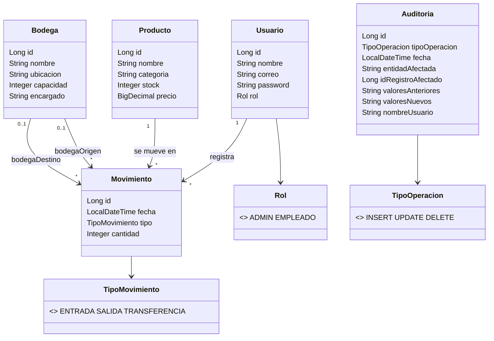

# 📦 LogiTrack — Sistema de Gestión y Auditoría de Bodegas
 
Backend en **Spring Boot 3.4.1 (Java 21)** con autenticación **JWT**, auditoría automática de cambios y documentación **Swagger/OpenAPI 3**, más un **frontend básico en HTML/CSS/JS** para probar el login y las consultas principales.
 
---
 
## 1. Descripción del proyecto
 
**LogiTrack S.A.** administra varias bodegas en distintas ciudades, donde se almacenan productos y se registran movimientos de inventario (entradas, salidas y transferencias). Hasta ahora el control se hacía en hojas de cálculo, sin trazabilidad ni control de accesos.
 
Este sistema centraliza esa operación y permite:
 
- Controlar los movimientos de inventario entre bodegas.
- Registrar automáticamente los cambios (auditoría) con el usuario responsable.
- Proteger la información con autenticación JWT y roles (`ADMIN` / `EMPLEADO`).
- Exponer endpoints REST documentados y seguros.
**Objetivo general:** gestionar bodegas y productos, registrar transacciones de inventario y generar registros auditables de los cambios hechos por cada usuario.
 
---
 
## 2. Tecnologías
 
| Capa | Tecnología |
|---|---|
| Lenguaje / Framework | Java 21, Spring Boot 3.4.1 |
| Persistencia | Spring Data JPA (Hibernate) + **MySQL** |
| Seguridad | Spring Security + JWT (jjwt 0.12.3) + BCrypt |
| Validación | Jakarta Validation (`@NotNull`, `@Size`, `@Min`, `@Email`, ...) |
| Documentación | springdoc-openapi 2.8.4 (Swagger UI) |
| Utilidades | Lombok |
| Servidor | Tomcat embebido (puerto 8080) |
| Frontend | HTML5, CSS3, JavaScript (fetch API) |
| Build | Maven (wrapper incluido: `mvnw`) |
 
---
 
## 3. Estructura del proyecto
 
```
logitrack/                                  ← Backend
├─ pom.xml
├─ src/main/java/com/example/logitrack/
│  ├─ LogitrackApplication.java
│  ├─ config/        DataInitializer, OpenApiConfig, SpringContextHolder
│  ├─ controller/    Auth, Bodega, Producto, Movimiento, Usuario, Auditoria
│  ├─ dto/           LoginRequest
│  ├─ exception/     ManejadorGlobalDeExcepciones, ErrorResponse, RecursoNoEncontradoException
│  ├─ modelo/        Bodega, Producto, Movimiento, Usuario, Auditoria, Rol, TipoMovimiento, TipoOperacion
│  ├─ repository/    Interfaces JpaRepository
│  ├─ security/      SecurityConfig, JwtUtils, JwtAuthenticationFilter, AuditoriaListener
│  └─ service/       Lógica de negocio
└─ src/main/resources/application.properties
 
Frontend/                                   ← Cliente web
├─ login.html
├─ index.html      (dashboard + vistas de productos, bodegas, movimientos, auditoría)
├─ css/            login.css, styles.css
└─ js/             config.js, api.js, auth.js, dashboard.js, productos.js,
                   bodegas.js, movimientos.js, auditoria.js
```
 
> La estructura sugerida usaba `model/`; en este proyecto el paquete se llama `modelo/`.
 
---
 
## 4. Instalación y ejecución
 
### Requisitos previos
 
- JDK 21
- MySQL 8+ en ejecución
- (Opcional) Maven; si no, se usa el wrapper `mvnw`
### 4.1 Base de datos
 
Ajusta las credenciales en `src/main/resources/application.properties`:
 
```properties
spring.datasource.url=jdbc:mysql://localhost:3306/logitrack_db?createDatabaseIfNotExist=true
spring.datasource.username=root
spring.datasource.password=1234
spring.jpa.hibernate.ddl-auto=update
server.port=8080
```
 
La base `logitrack_db` se crea sola (`createDatabaseIfNotExist=true`) y Hibernate genera las tablas al arrancar (`ddl-auto=update`).
 
### 4.2 Ejecutar el backend
 
```bash
cd logitrack
./mvnw spring-boot:run          # Linux / macOS
mvnw.cmd spring-boot:run        # Windows
```
 
La API queda disponible en `http://localhost:8080`.
 
### 4.3 Usuario inicial
 
Al primer arranque, `DataInitializer` crea un administrador (si no existe):
 
| Campo | Valor |
|---|---|
| Correo | `admin@logitrack.com` |
| Contraseña | `12345` |
| Rol | `ADMIN` |
 
> ⚠️ Cambia esta contraseña y la del `application.properties` antes de cualquier uso real.
 
### 4.4 Ejecutar el frontend
 
El frontend es estático y consume la API en `http://localhost:8080` (configurable en `Frontend/js/config.js`).
 
```bash
cd Frontend
python -m http.server 5500
# abrir http://localhost:5500/login.html
```
 
También puedes abrir `login.html` directamente o usar la extensión *Live Server* de VS Code. El backend ya tiene CORS habilitado.
 
### 4.5 Swagger UI
 
```
http://localhost:8080/swagger-ui/index.html
```
 
---
 
## 5. Modelo de datos
 
### Diagrama de clases
 

 
`Auditoria` guarda el **nombre del usuario como texto** (no como llave foránea), para conservar el historial aunque el usuario se elimine después.
 
---
 
## 6. Arquitectura
 
Arquitectura en capas clásica de Spring Boot:
 
```
Cliente (Frontend / Swagger)
        │  HTTP + JSON  (Authorization: Bearer <JWT>)
        ▼
JwtAuthenticationFilter ──► SecurityConfig (reglas por ruta y rol)
        ▼
Controller  ──►  Service  ──►  Repository  ──►  MySQL
                    │
                    └─ ManejadorGlobalDeExcepciones (@RestControllerAdvice)
 
Entity (Producto) ──► AuditoriaListener (@PostPersist/@PostUpdate/@PreRemove)
                           └─► AuditoriaRepository ──► tabla auditoria
```
 
- **Controller:** expone los endpoints REST.
- **Service:** lógica de negocio (p. ej. actualización de stock al registrar un movimiento).
- **Repository:** acceso a datos con Spring Data JPA.
- **Security:** filtro JWT sin estado (`STATELESS`), CSRF desactivado, CORS abierto, contraseñas con BCrypt.
- **Auditoría:** `AuditoriaListener` (JPA `EntityListeners`) toma el usuario del `SecurityContext` y guarda el registro automáticamente.
---
 
## 7. Seguridad y JWT
 
### Flujo
 
1. `POST /auth/login` con correo y contraseña.
2. El servidor valida con BCrypt y devuelve un token firmado (HS256, vigencia **24 h**).
3. El cliente envía el token en cada petición: `Authorization: Bearer <token>`.
4. `JwtAuthenticationFilter` valida el token y carga usuario y rol (`ROLE_ADMIN` / `ROLE_EMPLEADO`).
### Ejemplo de token
 
Petición:
 
```http
POST /auth/login
Content-Type: application/json
 
{ "correo": "admin@logitrack.com", "password": "12345" }
```
 
Respuesta:
 
```json
{ "token": "eyJhbGciOiJIUzI1NiJ9.eyJzdWIiOiJhZG1pbjEiLCJyb2xlIjoiQURNSU4iLCJpYXQiOjE3NjM0MjAwMDAsImV4cCI6MTc2MzUwNjQwMH0.<firma>" }
```
 
Payload decodificado (ejemplo ilustrativo):
 
```json
{
  "sub": "admin1",
  "role": "ADMIN",
  "iat": 1763420000,
  "exp": 1763506400
}
```
 
> El `sub` es el **nombre** del usuario (no el correo). La firma real depende de la clave secreta del servidor.
 
Uso del token:
 
```bash
curl http://localhost:8080/productos \
  -H "Authorization: Bearer <TOKEN>"
```
 
### Uso en Swagger
 
1. Ejecuta `POST /auth/login` y copia el valor de `token`.
2. Pulsa **Authorize** 🔒 (arriba a la derecha).
3. Pega el token (sin la palabra `Bearer`) y confirma.
4. Los endpoints protegidos ya se pueden probar desde la interfaz.
### Permisos por ruta
 
| Ruta | ADMIN | EMPLEADO |
|---|:-:|:-:|
| `/auth/**`, Swagger | ✅ público | ✅ público |
| `GET/POST/PUT /bodegas`, `/productos`, `/movimientos`, `/usuarios` | ✅ | ✅ |
| `DELETE /bodegas`, `/productos`, `/usuarios` | ✅ | ❌ (403) |
| `/auditorias/**` | ✅ | ❌ (403) |
 
---
 
## 8. Endpoints
 
Base URL: `http://localhost:8080`
 
### Autenticación
| Método | Ruta | Descripción |
|---|---|---|
| POST | `/auth/login` | Devuelve el token JWT |
 
### Bodegas
| Método | Ruta | Descripción |
|---|---|---|
| GET | `/bodegas` | Listar |
| GET | `/bodegas/{id}` | Consultar por id |
| POST | `/bodegas` | Crear |
| PUT | `/bodegas/{id}` | Actualizar |
| DELETE | `/bodegas/{id}` | Eliminar (solo ADMIN) |
 
### Productos
| Método | Ruta | Descripción |
|---|---|---|
| GET | `/productos` | Listar |
| GET | `/productos/{id}` | Consultar por id |
| POST | `/productos` | Crear |
| PUT | `/productos/{id}` | Actualizar |
| DELETE | `/productos/{id}` | Eliminar (solo ADMIN) |
| GET | `/productos/stock-bajo` | Productos con stock < 10 |
 
### Movimientos
| Método | Ruta | Descripción |
|---|---|---|
| GET | `/movimientos` | Listar |
| GET | `/movimientos/{id}` | Consultar por id |
| POST | `/movimientos` | Registrar entrada, salida o transferencia |
| DELETE | `/movimientos/{id}` | Eliminar |
 
### Usuarios
| Método | Ruta | Descripción |
|---|---|---|
| GET / GET `{id}` | `/usuarios` | Consultar |
| POST | `/usuarios` | Crear (la contraseña se guarda con BCrypt) |
| PUT / DELETE | `/usuarios/{id}` | Actualizar / eliminar (DELETE solo ADMIN) |
 
### Auditoría (solo ADMIN)
| Método | Ruta | Descripción |
|---|---|---|
| GET | `/auditorias` | Listar registros |
| GET | `/auditorias/{id}` | Consultar uno |
 
### Ejemplos
 
**Crear un producto**
 
```http
POST /productos
Authorization: Bearer <TOKEN>
Content-Type: application/json
 
{ "nombre": "Laptop Lenovo", "categoria": "Tecnología", "stock": 25, "precio": 2500000 }
```
 
**Registrar una entrada** (el usuario y la fecha los asigna el servidor desde el token)
 
```http
POST /movimientos
Authorization: Bearer <TOKEN>
Content-Type: application/json
 
{
  "tipo": "ENTRADA",
  "cantidad": 10,
  "producto": { "id": 1 },
  "bodegaDestino": { "id": 1 }
}
```
 
**Respuesta de error (404)**
 
```json
{
  "timestamp": "2026-11-17T21:30:00",
  "status": 404,
  "error": "Recurso No Encontrado",
  "message": "Producto no encontrado con ID: 99",
  "path": "/productos/99"
}
```
 
**Registro de auditoría generado automáticamente**
 
```json
{
  "id": 1,
  "tipoOperacion": "INSERT",
  "fecha": "2026-11-17T21:30:00",
  "entidadAfectada": "Producto",
  "idRegistroAfectado": 1,
  "nombreUsuario": "admin1"
}
```
 
---
 
## 9. Frontend
 
Carpeta `Frontend/`, HTML/CSS/JS puro, sin dependencias.
 
| Archivo | Función |
|---|---|
| `login.html` + `auth.js` | Inicio de sesión; guarda token, rol y usuario en `localStorage` |
| `api.js` | `apiRequest()` central: agrega el token y maneja 401 / 403 / errores del servidor |
| `index.html` | Dashboard con navegación entre vistas |
| `dashboard.js` | Totales de productos, bodegas, stock bajo y movimientos recientes |
| `productos.js`, `bodegas.js` | CRUD con modales (editar/eliminar solo visible para ADMIN) |
| `movimientos.js` | Historial y registro de movimientos (muestra origen/destino según el tipo) |
| `auditoria.js` | Tabla del registro de auditoría |
 
---
 
## 10. Manejo de errores y validaciones
 
- `ManejadorGlobalDeExcepciones` (`@RestControllerAdvice`) devuelve JSON personalizado:
  - `404` → `RecursoNoEncontradoException`
  - `400` → errores de negocio, JSON mal formado y validaciones (`MethodArgumentNotValidException`)
  - `500` → cualquier error inesperado
- Validaciones declaradas en las entidades: `@NotNull`, `@NotBlank`, `@Size`, `@Min`, `@DecimalMin`, `@Email`.
- Reglas de negocio: no permitir stock negativo en una salida, correo de usuario único, producto obligatorio en un movimiento.
---
 

 
## 11. Autor
 
Proyecto académico — **LogiTrack S.A.** · Sistema de gestión de bodegas.
 
